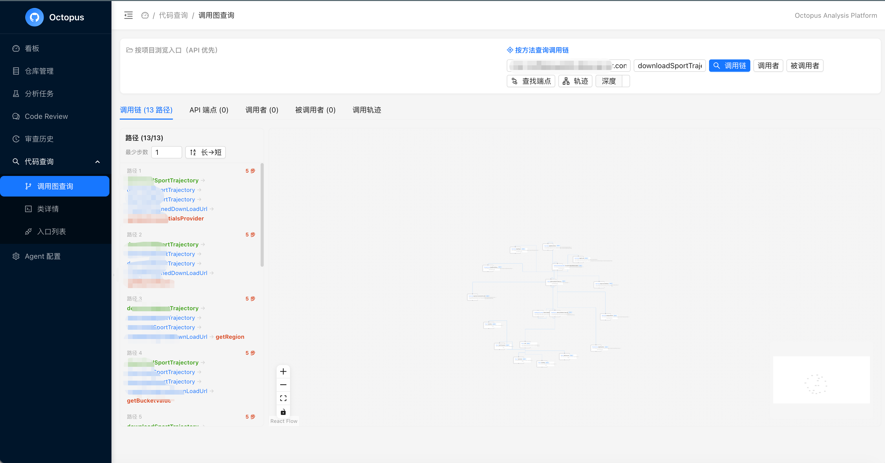
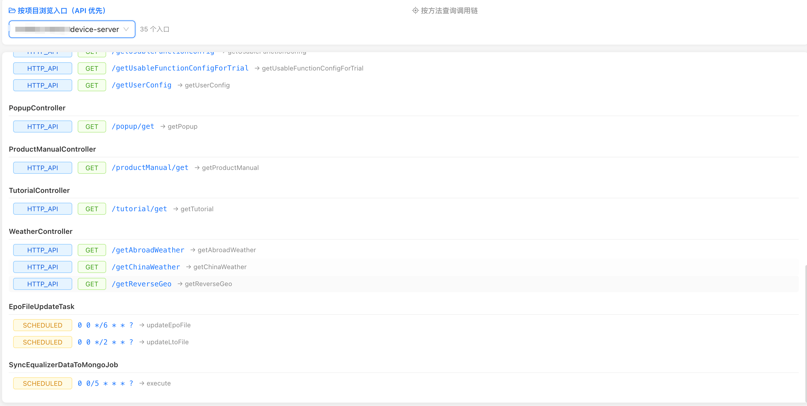
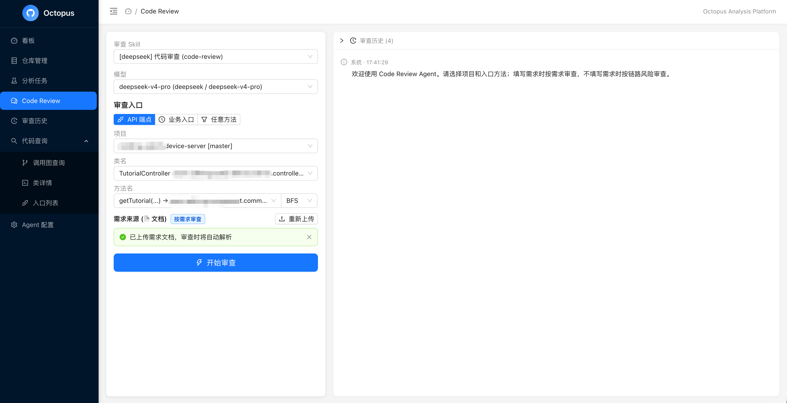

# Octopus — Multi-Language Code Impact Analysis Platform

> **Post-commit quality decisions: extract call chains from commits/tags, locate change impact scope, determine test boundaries, and provide traceable source-level evidence for requirement-aware LLM review and version-evolution tracking.**
>
> **Core design: A Language Adapter architecture decouples language analysis from the core engine. Each language needs only one Adapter to plug into the full analysis pipeline.**

---

## 1. The Problem

Agent tools like Claude Code, Cursor, and Codex already excel at extracting call graphs and retrieving context **during coding**. Octopus does not solve that problem.

Octopus focuses on the quality closure loop **after code is committed**:

| Problem | Risk | How Octopus Solves It |
|---------|------|-----------------------|
| **Only file diffs are visible** | Unknown which endpoints, services, or downstream dependents are affected | Enumerate upstream callers, downstream callees, and full affected paths by method/function nodes |
| **Test scope relies on intuition** | Small changes may miss critical paths; large changes over-test | Narrow or widen test scope based on call-chain impact paths with explainable evidence |
| **Framework-implicit relations are invisible** | DI, AOP, event routing, async scheduling break the call chain | Adapters register semantic extractors for each language's mainstream frameworks |
| **LLM Review lacks business context** | Reviewing isolated diffs misses requirement semantics | Resolve requirements to call paths, restore per-step source code for focused LLM review |
| **Version evolution is hard to trace** | Path changes across tags/commits require manual comparison | Save graph snapshots by branch/tag/commit; compare endpoint-level path diffs across versions |

**In one sentence: Turn code changes into queryable, explainable, auditable impact scope and source evidence.**

---

## 2. Architecture

### Overview

```
┌──────────────────────────────────────────────────────────────────┐
│  octopus-frontend (React 19, Port 3000)                         │
│  Dashboard · Query · Code Review · Review History · Admin      │
└──────────────────────────┬───────────────────────────────────────┘
                           │ HTTP
                           ▼
┌──────────────────────────────────────────────────────────────────┐
│  code-intelligence (Spring Boot, Port 8080)                     │
│                                                                │
│  ┌─────────────────┐  ┌────────────────┐  ┌───────────────┐   │
│  │ Analysis         │  │ CallGraph      │  │ Query / Diff  │   │
│  │ Orchestration    │──│ Build Service  │──│ / Source      │   │
│  │ Service          │  │                │  │ Services      │   │
│  └────────┬─────────┘  └────────┬───────┘  └───────────────┘   │
│           │                     │                               │
│           ▼                     ▼                               │
│  ┌─────────────────────────────────────────────────────┐       │
│  │  LanguageAdapterRegistry — routes by file extension  │       │
│  │  ┌──────────┐ ┌──────────┐ ┌──────────┐ ┌───────┐  │       │
│  │  │ JVM PSI  │ │ JavaParser│ │ Kotlin   │ │ Python│  │ ...   │
│  │  │ Adapter  │ │ Adapter  │ │ Adapter  │ │ (TODO)│  │       │
│  │  └────┬─────┘ └────┬─────┘ └────┬─────┘ └───────┘  │       │
│  └───────┼────────────┼────────────┼───────────────────┘       │
│          │            │            │                            │
│          ▼            ▼            ▼                            │
│  ┌────────────────────────────────────────────────────┐        │
│  │  GitService · GraphStore (Neo4j) · MetadataStore  │        │
│  │  (MySQL) · ReconstructService                     │        │
│  └────────────────────────────────────────────────────┘        │
└──────────────────────────┬──────────────────────────────────────┘
          │                 │                 │
          ▼                 ▼                 ▼
┌──────────────┐  ┌──────────────┐  ┌──────────────────┐
│ octopus-git   │  │   Neo4j      │  │   MySQL          │
│ (Port 8081)  │  │  Graph DB    │  │  Relational DB   │
└──────────────┘  └──────────────┘  └──────────────────┘

┌──────────────────────────────────────────────────────────────────┐
│  octopus-review-agent (AI Code Review, Port 8083)               │
│  LLM-based code review with Skill engine + Knowledge memory     │
└──────────────────────────────────────────────────────────────────┘
```



### Modules

| Module | Responsibility | Port |
|--------|---------------|------|
| **code-intelligence** | Core backend — orchestration, Adapter dispatch, query API, call graph construction | 8080 |
| **jvm-project-analyzer** | JVM Adapter — IntelliJ PSI plugin (Java/Kotlin deep semantic analysis) | 8377 |
| **octopus-git** | Git operations microservice | 8081 |
| **octopus-code-reconstruct** | Call-chain source code restoration service | 8082 |
| **octopus-review-agent** | AI Code Review agent | 8083 |
| **octopus-infra/\*** | Shared infrastructure | — |
| **octopus-frontend** | React SPA | 3000 |

### Adapter Dispatch Flow

```
AnalysisOrchestrationService
         │
         ▼
LanguageAdapterRegistry.getAdapter(fileExtension)
         │
         ├── .java / .kt ──→ JVM Adapter (PSI preferred, JavaParser fallback)
         ├── .py           ──→ Python Adapter (Sidecar process, LSP-driven)
         ├── .ts / .js     ──→ TypeScript Adapter (Sidecar, ts-morph)
         └── ...           ──→ Unregistered → skip / basic text scan
```

Each adapter returns results in a standard format, merged by `CallGraphBuildService` and written to Neo4j.

---

## 3. The JVM Adapter — Why PSI + JavaParser

The most mature Adapter implementation is the **JVM Adapter**, powered by a dual-engine design of IntelliJ PSI (deep) and JavaParser (lightweight).

### IntelliJ PSI (Program Structure Interface)

**PSI is IntelliJ IDEA's underlying parsing engine, serving as the JVM Adapter's "deep" analyzer.**

**Strengths:**

| Capability | Description |
|------------|-------------|
| **Semantic-level parsing** | Full symbol resolution (types, method binding, overload resolution, generics) — not just AST |
| **Framework awareness** | Recognizes `@Autowired`, `@EventListener`, `@Async`, `@Scheduled`, AOP aspects, etc. |
| **Cross-file/module resolution** | `resolveMethod()` pinpoints the actual definition, correctly resolving interface polymorphism |
| **Mixed languages** | Built-in Kotlin support for Java + Kotlin projects |

**Weaknesses:**

| Issue | Impact |
|-------|--------|
| Slow startup (30-120s), high memory (2-4 GB) | Unsuitable for batch, stateless parsing |
| Complex deployment | Requires ~1.1 GB IDEA download; Xvfb for headless display in containers |
| Per-project isolation | Each project opens and indexes independently; no state reuse |

### JavaParser (Lightweight Fallback)

Pure Java library, millisecond startup, no type system, no framework semantics. Automatic fallback when PSI is unavailable or deep semantics aren't needed.

**Dual-engine collaboration:**
1. **PSI first** — attempt PSI for deep analysis (call edges + Spring semantics)
2. **Auto fallback** — seamless degradation to JavaParser when PSI is unavailable
3. **JavaParser supplement** — even when PSI succeeds, JavaParser provides source text and precise location info
4. **Merge & persist** — both results are merged by `CallGraphBuildService` and written to Neo4j + MySQL

---

## 4. Workflow

### 4.1 Trigger Analysis

Trigger a task against a repo's branch, tag, or commit. The system syncs code, dispatches to the appropriate Language Adapter by file extension, and persists method nodes, call edges, source locations, and version info.

### 4.2 Query Impact Scope



Query the call chain around a changed method:
- **upstream** — which endpoints, services, or tasks call this method
- **downstream** — which downstream dependencies this method affects
- **affected paths** — the full path assembled from upstream to downstream

Used to determine which test entry points need regression: API endpoints, message listeners, scheduled tasks, service root methods, etc.

### 4.3 Source Restoration + LLM Review



When a path is associated with a requirement, restore the source code of each method along that path — narrowing the review context from "the entire repo" to "requirement-related call chain + original source + version diff". The LLM can then judge:

- Is the requirement implemented at the correct layer?
- Are validation, authorization, transactions, and exception handling consistent along the chain?
- Does the change break old behavior or miss downstream side effects?

### 4.4 Version Diffing

Compare the downstream path set of the same endpoint across two commits/tags to identify added, removed, and unchanged paths.

---

## 5. Deployment & Quick Start

### Prerequisites

- Java 21+
- Docker & Docker Compose
- Node.js 20+
- Git

### Start Infrastructure (MySQL + Neo4j)

```bash
docker run -d --name mysql-octopus \
  -e MYSQL_ROOT_PASSWORD=root \
  -e MYSQL_DATABASE=octopus \
  -p 3306:3306 mysql:8.0

docker run -d --name neo4j-octopus \
  -e NEO4J_AUTH=neo4j/octopus123 \
  -p 7474:7474 -p 7687:7687 neo4j:5
```

### Start Git Microservice & Frontend

```bash
docker compose up -d git frontend
```

### Start PSI Analysis Service (JVM Adapter)

```bash
# macOS (first run downloads IntelliJ IDEA IU 2025.3, ~1.1 GB)
./run-jvm-analyzer-local.sh
```

PSI service listens on `localhost:8377`.

### Start the App

```bash
# Terminal 1: backend
./gradlew :code-intelligence:bootRun

# Terminal 2: frontend dev mode
cd octopus-frontend && npm run dev
```

### Trigger an Analysis

```bash
# Analyze a local directory (no Git repo needed)
curl -X POST http://localhost:8080/api/analysis/local \
  -H "Content-Type: application/json" \
  -d '{"projectPath": "/path/to/your/project"}'

# Analyze a Git repo tag
curl -X POST "http://localhost:8080/api/analysis/1?tag=v1.0.0"
```

### Docker Deployment

Hybrid mode (Git service + frontend in Docker; backend + PSI on host):

```bash
docker compose up -d
```

Full container mode:

```bash
docker compose -f docker-compose.yml -f docker-compose.jvm-analyzer.yml up -d
```

### Key Environment Variables

| Variable | Default | Description |
|----------|---------|-------------|
| `MYSQL_PASSWORD` | `root` | MySQL password |
| `NEO4J_PASSWORD` | `octopus123` | Neo4j password |
| `GIT_PASSWORD` | — | Git server authentication password |
| `OCTOPUS_ENCRYPTION_KEY` | — | AES encryption key (Git credential encryption) |

---

## 6. Roadmap

- **Non-JVM Adapters**: Prioritize TypeScript/JavaScript (NestJS/Express route semantics) and Python (Django/FastAPI route semantics)
- **Adapter Sidecar Protocol Standardization**: Define HTTP/gRPC communication protocol for cross-language adapters; each language analyzer runs as an independent process/container
- **Incremental Analysis Stability**: Improve PSI index incremental update reliability; reduce full-analysis cost for large repos
- **Runtime Strategy Pattern Resolution**: Eliminate impossible candidate edges for patterns like `Map<String, Strategy>`, strategy registries, config-driven routing
- **Review Agent Observability**: Review session duration distribution, token consumption, Skill execution traces
- **CI/CD Native Integration**: Standardized GitHub Actions / GitLab CI pipeline — commit triggers analysis triggers feedback

---

## 7. Language Adapter Extension Guide

Octopus treats Adapters as a **first-class abstraction**: the core engine is language-agnostic. Every language plugs in by implementing a unified interface.

### Adapter Interface

```java
public interface LanguageAdapter {
    /** File extensions this adapter supports */
    boolean supports(String fileExtension);
    /** Scan project structure, return module list */
    List<ProjectModule> scanProject(Path projectRoot);
    /** Run analysis, return nodes, edges, source evidence */
    AnalysisResult analyze(Path projectRoot, AnalysisContext ctx);
    /** Whether this adapter requires an external engine process (PSI, LSP Server, etc.) */
    boolean requiresExternalEngine();
}
```

### Current Adapter Status

| Adapter | Engine | Status | Capability |
|---------|--------|--------|------------|
| **JVM PSI** | IntelliJ PSI | ✅ Production | Full semantics, Spring framework understanding, 15 call-edge types, mixed languages |
| **JavaParser** | JavaParser | ✅ Production | Lightweight AST parsing, auto-fallback, source text extraction |
| **Kotlin** | IntelliJ PSI | ✅ Built-in | Native support via Kotlin plugin |
| **TypeScript** | ts-morph | ⏳ Planned | Sidecar process, AST + type info |
| **Python** | Jedi / LSP | ⏳ Planned | LSP protocol integration |

### Four Steps to Add a New Language

**Step 1: Choose the Runtime Mode**

| Mode | Use Case | Example |
|------|----------|---------|
| **Embedded library** | Language has a JVM library | JavaParser (pure Java) |
| **Sidecar process** | Requires native toolchain | TypeScript (ts-morph via Node.js), Python (Jedi via Python process) |
| **External HTTP service** | Existing analysis service | IntelliJ PSI (standalone HTTP service) |

**Step 2: Implement `LanguageAdapter`**

- `supports(fileExtension)` — tell the engine which files to handle
- `scanProject(projectRoot)` — discover module structure (Maven/Gradle/pyproject.toml/package.json)
- `analyze(projectRoot, ctx)` — core logic returning `AnalysisResult` (method nodes + call edges + source snippets)

**Step 3: Register Framework Semantic Extractors**

Every language's mainstream framework has implicit call relations (route registration, DI, event bus, AOP). Model your extractor after `SpringModelExtractor`:

| Framework | Implicit Relations | Corresponding Edge Types |
|-----------|-------------------|--------------------------|
| Spring (Java) | `@Autowired`, `@EventListener`, AOP, `@Scheduled` | SPRING_DI, EVENT, AOP_*, SCHEDULED |
| NestJS (TS) | `@Controller`, `@Injectable`, `@EventPattern` | SPRING_DI, EVENT |
| Django (Python) | `urlpatterns`, signal, middleware | ROUTE, EVENT |
| FastAPI (Python) | route decorator, Depends, BackgroundTasks | ROUTE, SPRING_DI |

**Step 4: Register with `LanguageAdapterRegistry`**

```java
@Component
public class TypeScriptAdapter implements LanguageAdapter {
    @Override
    public boolean supports(String ext) {
        return Set.of(".ts", ".tsx", ".js", ".jsx").contains(ext);
    }

    @Override
    public AnalysisResult analyze(Path projectRoot, AnalysisContext ctx) {
        // Invoke Node.js Sidecar process with file list
        // Receive standard JSON result
        // Return AnalysisResult
    }
}
```

Then register via config:

```yaml
octopus:
  adapters:
    typescript:
      enabled: true
      sidecar-command: node /opt/octopus-ts-adapter/index.js
      sidecar-port: 9100
```

### Reference: TypeScript Adapter Design

```
code-intelligence                              Node.js Sidecar
┌──────────────────────┐     HTTP/stdio        ┌──────────────────────┐
│  TypeScriptAdapter   │ ──────────────────→   │  ts-morph /          │
│  (Java, Language     │                       │  @typescript-estree  │
│   Adapter impl)      │ ←──────────────────   │                      │
│                      │   JSON result          │  Route extractor    │
└──────────────────────┘                       │  (NestJS/Express)   │
                                               └──────────────────────┘
```

Sidecar output standard format:

```json
{
  "nodes": [
    { "id": "123", "file": "src/controller/UserController.ts",
      "className": "UserController", "methodName": "getUser",
      "parameters": ["id: string"], "returnType": "Promise<User>" }
  ],
  "edges": [
    { "source": "123", "target": "456",
      "type": "DIRECT", "sourceLine": 25,
      "sourceSnippet": "return this.userService.findById(id)" }
  ],
  "frameworkEdges": [
    { "route": "GET /api/users/:id", "handler": "123",
      "type": "ROUTE" }
  ],
  "sourceFiles": {
    "src/controller/UserController.ts": "full source text..."
  }
}
```

---

## Tech Stack

| Layer | Technology |
|-------|-----------|
| **Runtime** | Java 21, Spring Boot 4.0.5 |
| **Build** | Gradle 9.4.1 (multi-module) |
| **Relational DB** | MySQL 8.0 |
| **Graph DB** | Neo4j 5.x |
| **JVM Deep Parser** | IntelliJ Platform IU 2025.3 (PSI) |
| **JVM Lightweight Parser** | JavaParser 3.26.4 |
| **Git** | JGit 7.6.0 |
| **Frontend** | React 19, TypeScript 6, Vite 8, Ant Design 5 |
| **Graph Visualization** | @xyflow/react 12.x, dagre |
| **Containerization** | Docker, Docker Compose |

---

## License

[MIT License](LICENSE)
