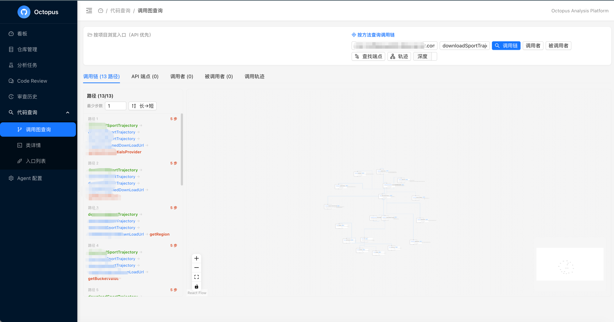
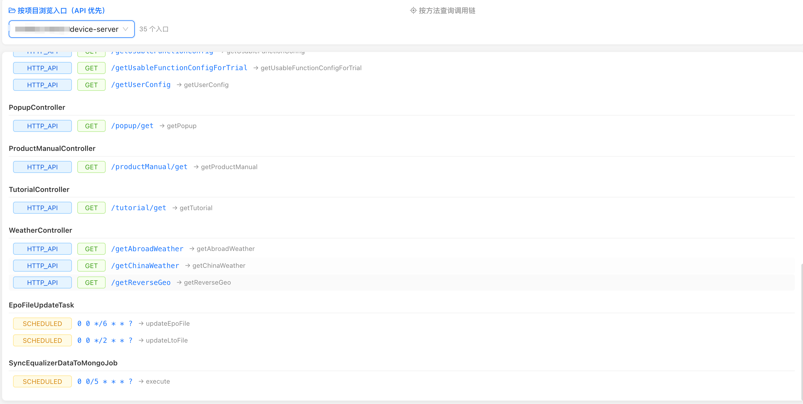
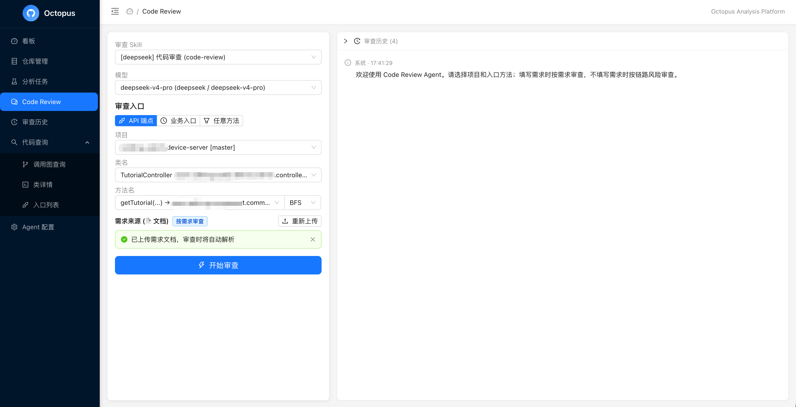

# Octopus — 多语言代码影响分析平台

> **面向代码提交后的质量决策：基于 commit / tag 提取调用链，定位变更影响范围，辅助确定测试范围，并为需求语义级 LLM Review 和版本演进追踪提供可回溯的源码证据。**
>
> **核心设计：通过 Language Adapter 架构解耦语言分析与核心引擎，每种语言只需实现一个 Adapter 即可接入完整分析链路。**

---

## 0. 快捷指引

**五分钟拉起全栈**（前置见 §5；`OCTOPUS_ENCRYPTION_KEY` 需 16/24/32 字节）：

```bash
docker compose -f docker-compose.infra.yml up -d    # MySQL + Neo4j + RabbitMQ
./run-jvm-analyzer-local.sh                         # JVM 分析服务 :8377（首次启动较慢）
./run-go-analyzer-local.sh                          # Go 分析服务 :8378（秒级）
GIT_PASSWORD=dummy OCTOPUS_ENCRYPTION_KEY=0123456789abcdef0123456789abcdef \
  ./gradlew :code-intelligence:bootRun              # 后端 :8080
cd octopus-frontend && npm install && npm run dev   # 前端 :3000
```

**发起第一次分析**——打开 <http://localhost:3000> 在"分析任务"页提交本地目录，或：

```bash
curl -X POST http://localhost:8080/api/analysis/local \
  -H 'Content-Type: application/json' \
  -d '{"projectPath": "/path/to/your/repo"}'
```

**页面速查**：

| 页面 | 用途 |
|------|------|
| `/change-summary` 变更总结 | 选入口 + 两个版本（分支/commit/tag 任意组合）→ 修改要点 + 测试要点 |
| `/review` Code Review | Jira 工单号 / 文档 / 手动输入需求 → 结构化审查 → 底部追问 |
| `/query/callgraph` 调用图查询 | 入口浏览（API 优先）、调用链 / 上下游 / 影响路径 |
| `/query/class`、`/query/endpoints` | 类详情、入口列表 |
| `/admin` Agent 配置 | 模型管理（API 格式 + 密钥加密存储）、Prompt、Skill、需求源（Jira） |
| `/analysis` 分析任务 | 分析状态 / 步骤 / 重试；多分支分析后版本随时可查 |

**审查前置**：在 Agent 配置页注册至少一个 LLM 模型（Base URL / 账号 / API Key / API 格式——OpenAI 兼容或 Claude）。

**端口一览**：3000 前端 · 8080 后端 · 8082 源码还原（git 切片）· 8083 review-agent · 8377 JVM 分析 · 8378 Go 分析 · 3306/7687/5672 MySQL/Neo4j/RabbitMQ

---

## 1. 项目主要解决的问题

Claude Code、Cursor、Codex 等 Agent 工具，以及 GitHub Code Navigation、ast-grep、编辑器内置符号索引等基于 tree-sitter 的方案，已经具备在**编码阶段**提取调用关系、检索上下文的能力。它们的共同边界是**语法级**——CST 遍历与名字匹配：无类型绑定（重载/接口分派不可分辨）、无框架语义、无版本化影响面。Octopus 不重复解决这个问题，而是补上它们覆盖不到的、**代码已经提交到仓库之后**的工程质量闭环：

| 问题 | 风险 | Octopus 如何解决 |
|------|------|-----------------|
| **只看到文件 diff** | 不知道修改会影响哪些入口、服务和下游依赖 | 以方法/函数为节点枚举 upstream、downstream 和完整 affected paths |
| **语法级索引精度不足** | tree-sitter/ctags 系按名字匹配，重载、接口分派、多态调用不可分辨 | go/types、IntelliJ PSI 类型精确解析；接口分派按类型系统扇出 |
| **测试范围靠经验判断** | 小改动可能漏测关键链路，大改动又容易过度回归 | **精准测试**：基于调用链影响路径圈定回归范围（受影响入口 = 回归用例集），并保留可解释证据 |
| **框架隐式关系不可见** | DI、AOP、事件路由、异步调度等框架机制导致链路断裂 | Adapter 为各语言主流框架注册语义提取器 |
| **LLM Review 缺少业务上下文** | 只审查局部 diff，难判断是否满足需求语义 | 将需求关联到链路后，按路径还原每一步源码供 LLM Review |
| **版本演进难追溯** | 不同 tag/commit/分支的链路变化只能人工比对 | 按 branch/commit 维度保存图谱快照；链路成员+源码 git 对比，LLM 产出修改/测试要点 |

**一句话：把代码变更转化为可查询、可解释、可审计的影响范围和源码证据——落地精准测试（基于变更影响面圈定回归范围）。**

---

## 2. 项目架构

### 架构总览

```
┌──────────────────────────────────────────────────────────────────┐
│  octopus-frontend (React 19, Port 3000)                         │
│  Dashboard · 分析任务 · 变更总结 · Code Review(+追问) · 审查历史  │
│  代码查询(调用图/类详情/入口) · 仓库管理 · Agent 配置             │
└──────────────────────────┬───────────────────────────────────────┘
                           │ HTTP
                           ▼
┌──────────────────────────────────────────────────────────────────┐
│  code-intelligence (Spring Boot, Port 8080)                     │
│                                                                │
│  ┌─────────────────┐  ┌────────────────┐  ┌───────────────┐   │
│  │ Analysis         │  │ CallGraph      │  │ Query / Diff  │   │
│  │ Orchestration    │──│ Build Service  │──│ / Source      │   │
│  │ Service          │  │                │  │ Services      │   │
│  └────────┬─────────┘  └────────┬───────┘  └───────────────┘   │
│           │                     │                               │
│           ▼                     ▼                               │
│  ┌─────────────────────────────────────────────────────┐       │
│  │  AnalysisDispatcher — 按构建文件分发到语言适配器       │       │
│  │  ┌──────────────────┐  ┌──────────────────┐          │       │
│  │  │ JVM Adapter      │  │ Go Adapter       │  ...     │       │
│  │  │ (PSI 深度解析 +  │  │ (go/types 精确   │          │       │
│  │  │  JavaParser 降级)│  │  类型分析)       │          │       │
│  │  └────┬─────────────┘  └────┬─────────────┘          │       │
│  └───────┼─────────────────────┼─────────────────────────┘       │
│          │            │            │                            │
│          ▼            ▼            ▼                            │
│  ┌────────────────────────────────────────────────────┐        │
│  │  GitService · GraphStore (Neo4j) · MetadataStore  │        │
│  │  (MySQL) · ReconstructService                     │        │
│  └────────────────────────────────────────────────────┘        │
└──────────────────────────┬──────────────────────────────────────┘
          │                 │                 │
          ▼                 ▼                 ▼
┌──────────────┐  ┌──────────────┐  ┌──────────────────┐
│ octopus-git   │  │   Neo4j      │  │   MySQL          │
│ (Port 8081)  │  │  图数据库    │  │  关系数据库       │
└──────────────┘  └──────────────┘  └──────────────────┘

┌──────────────────────────────────────────────────────────────────┐
│  octopus-review-agent (AI Code Review, Port 8083)                │
│  Skill 引擎 + 结构化审查 + 追问对话 + 变更总结 + Jira 需求源     │
│  + 需求源 SPI + 模型管理（API 格式/AES-GCM 密钥加密）             │
└──────────────────────────────────────────────────────────────────┘
```



### 模块说明

| 模块 | 职责 | 端口 |
|------|------|------|
| **code-intelligence** | 核心后端 — 分析编排、Adapter 调度、查询 API、调用图构建 | 8080 |
| **jvm-project-analyzer** | JVM Adapter — IntelliJ PSI 插件（Java/Kotlin 深度语义分析） | 8377 |
| **go-project-analyzer** | Go Adapter — go/packages + go/types 调用图分析服务 | 8378 |
| **octopus-git** | Git 操作微服务 | 8081 |
| **octopus-code-reconstruct** | 调用路径源码还原（git blob 按行切片 + 批量坐标取源） | 8082 |
| **octopus-review-agent** | AI Code Review（Skill 引擎/追问对话/变更总结/需求源 SPI） | 8083 |
| **octopus-analysis-scheduler** | 定时/批量分析调度（RabbitMQ） | — |
| **octopus-scenario-runner** | 场景化 API 测试（Tool Registry / Runner） | 8086 |
| **octopus-jmeter-ext** | JMeter 扩展：前置数据准备与结果校验（DB/Redis/Kafka），由 scenario-runner 嵌入执行 | — |
| **octopus-code-base** | 仓库配置与 Git 同步（与 code-intelligence 共享 `repo_config` 表，仅附加 nullable 列）；计划并入 code-intelligence | 8084 |
| **octopus-infra/\*** | 共享基础设施（bom/common/mysql/neo4j/jgit/memory） | — |
| **octopus-frontend** | React SPA | 3000 |

### Adapter 分发流程

```
AnalysisOrchestrationService
         │
         ▼
AnalysisDispatcher.detectAnalyzer(projectRoot)   （无构建文件目录回退 JVM）
         │
         ├── pom.xml / build.gradle ──→ JVM Adapter (PSI 优先, JavaParser 降级)
         ├── go.mod                ──→ Go Adapter (go-project-analyzer 服务)
         └── ...                   ──→ 未注册 → 跳过/基础文本扫描
```

每种语言的分析结果以标准格式返回，由 `CallGraphBuildService` 统一合并后写入 Neo4j。

---

## 3. JVM Adapter 的设计 —— 为什么选择 PSI + JavaParser

当前最成熟的 Adapter 实现是 **JVM Adapter**，由 IntelliJ PSI（深度）和 JavaParser（轻量）双引擎构成。

### IntelliJ PSI（Program Structure Interface）

**PSI 是 IntelliJ IDEA 的底层解析引擎，作为 JVM Adapter 的"深度"分析器。**

**优势：**
| 能力 | 说明 |
|------|------|
| **语义级解析** | 不仅是 AST，而是完整的符号解析（类型、方法绑定、重载、泛型推导） |
| **框架感知** | 识别 `@Autowired`、`@EventListener`、`@Async`、`@Scheduled`、AOP 切面等框架语义 |
| **跨文件/跨模块引用** | `resolveMethod()` 可以定位方法实际定义位置，正确解析接口多态 |
| **混合语言** | 内置 Kotlin 支持，可分析 Java + Kotlin 混合项目 |

**劣势：**
| 问题 | 影响 |
|------|------|
| 启动慢（30-120s），内存高（2-4 GB） | 不适合批量快速解析 |
| 部署复杂 | 需要下载 ~1.1 GB IDEA，容器中需 Xvfb 模拟显示环境 |
| 单项目隔离 | 每个项目需要独立打开、索引，不能复用状态 |


### JavaParser（轻量级降级路径）

纯 Java 库，毫秒级启动，无类型系统、无框架语义。当 PSI 不可用或不需要深度语义时，automatic fallback。

**双引擎协作模式：**
1. **PSI 优先** — 先尝试 PSI 获取深度分析结果（调用边 + Spring 语义）
2. **自动降级** — PSI 不可用时无缝降级到 JavaParser（文本级源码提取）
3. **JavaParser 补充** — 即使 PSI 成功，JavaParser 仍提供源码文本和精确定位信息
4. **合并写入** — 两路结果由 `CallGraphBuildService` 合并后写入 Neo4j + MySQL

---

## 4. 交互流程

### 4.1 触发分析

对目标仓库的 branch/tag/commit 触发分析任务。系统按构建文件（`pom.xml`/`build.gradle` → JVM，`go.mod` → Go）分发到对应 Adapter、将方法节点、调用边、源码坐标和版本信息写入存储。

**同一仓库 = 一个 project，分支/commit 是版本维度**：多分支分析后数据按 `branch` 列共存，前端分支/commit 选择器从元数据枚举（`analyzed-branches` / `analyzed-commits`），历史版本随时可查。

### 4.2 查询影响范围



围绕被修改方法查询调用链，得到：
- **upstream** — 哪些入口、服务或任务会调用到该方法
- **downstream** — 该方法继续影响哪些下游依赖
- **affected paths** — 从上游到下游拼接后的完整链路

用于确定哪些测试入口需要回归：API 端点、消息监听器、定时任务、服务根方法等——这正是**精准测试**的核心：改了 X，就只回归调用到 X 的入口；配合变更总结生成的测试要点，直接产出回归用例清单。

### 4.3 源码还原 + LLM Review



当链路关联到需求时，按路径还原每一步方法源码（git blob 按行号切片），将 Review 上下文从"整个仓库"收敛为"需求相关调用链 + 原始源码 + 版本差异"。LLM 可据此判断：
- 需求规则是否在正确层级实现
- 参数校验、权限、事务、异常处理是否沿链路一致
- 变更是否破坏旧版本行为或遗漏下游副作用

**需求来源**：手动结构化输入 / 文档上传自动解析 / **Jira 工单拉取**（`RequirementSourceAdapter` SPI，默认内置 Jira——贴工单号即可拉取主单+子任务为需求条目；其他工单系统实现接口注册即用）。

**审查追问（混合形态对话层）**：结构化审查完成后，底部输入框可基于同一链路上下文继续追问（如"详细解释第二个风险"），issue 卡片带「追问此问题」快捷入口；问答按线程落库，支持刷新恢复。

### 4.4 变更总结（跨版本对比）

独立的「变更总结」页面：同一入口 + 两个版本（分支/commit/tag 任意组合，可跨分支），底层 `entry-chain-diff` 枚举两版链路成员集合做差集，**共同成员的源码文本按 method_info 坐标从 git blob 重新切片对比**（git 为源码内容唯一真相，`gitBacked` 标注来源），再由 LLM 产出结构化的**修改要点 + 测试要点**——从变更推导测试场景与回归点。

---

## 5. 部署与启动

### 前置条件

- Java 21+
- Docker 或 Podman（Compose 兼容即可，本文以 docker 命令示意）
- Node.js 20+
- Git
- Go >= 1.24（仅分析 Go 项目需要）

### 启动基础服务（MySQL + Neo4j + RabbitMQ）

```bash
# 一键（推荐，含 healthcheck）
docker compose -f docker-compose.infra.yml up -d

# 或逐个启动（注意：Neo4j 密码 octpus123 与应用默认保持一致，含历史拼写）
docker run -d --name mysql-octopus \
  -e MYSQL_ROOT_PASSWORD=root \
  -e MYSQL_DATABASE=octopus \
  -p 3306:3306 mysql:8.0

docker run -d --name neo4j-octopus \
  -e NEO4J_AUTH=neo4j/octpus123 \
  -p 7474:7474 -p 7687:7687 neo4j:5

docker run -d --name rabbitmq-octopus -p 5672:5672 -p 15672:15672 rabbitmq:3
```

### 启动基础设施微服务和前端

```bash
docker compose up -d git frontend
```

### 启动 PSI 分析服务（JVM Adapter）

```bash
# macOS（首次运行会下载 IntelliJ IDEA IU 2025.3，约 1.1 GB）
./run-jvm-analyzer-local.sh
```

PSI 服务监听 `localhost:8377`。

### 启动 Go 分析服务（Go Adapter）

```bash
./run-go-analyzer-local.sh   # 需本机 go >= 1.24

# 自定义路由框架白名单（框架画像：默认含 gin/echo/chi/gorilla-mux）
OCTOPUS_GO_ROUTER_PKGS="github.com/gofiber/fiber/v2,github.com/beego/beego/v2" ./run-go-analyzer-local.sh
# 或 ./run-go-analyzer-local.sh 内部: go-analyzer serve --routers pkg1,pkg2
```

Go 服务监听 `localhost:8378`，毫秒级启动、秒级分析（go/types 类型检查 + 接口扇出 + 路由注册识别，支持路由组前缀拼接）。未启动时 Go 项目分析任务会整体降级（DEGRADED，无回退解析器）。

### 启动 app

```bash
# 终端 1：后端
./gradlew :code-intelligence:bootRun

# 终端 2：前端开发模式
cd octopus-frontend && npm run dev
```

### 触发分析

```bash
# 分析本地目录
curl -X POST http://localhost:8080/api/analysis/local \
  -H "Content-Type: application/json" \
  -d '{"projectPath": "/path/to/your/project"}'

# 分析 Git 仓库标签
curl -X POST "http://localhost:8080/api/analysis/1?tag=v1.0.0"
```

### Docker 部署

混合部署（Git 服务和前端在 Docker，后端和 PSI 在宿主机）：

```bash
docker compose up -d
```

全容器模式（JVM 分析服务 + 后端 + 前端在容器内；MySQL/Neo4j/RabbitMQ、review-agent、reconstruct、scenario-runner 默认仍在宿主机，容器经 `host.docker.internal` 访问）：

```bash
export OCTOPUS_ENCRYPTION_KEY=0123456789abcdef0123456789abcdef   # 必填，缺失时 compose 直接报错
docker compose -f docker-compose.yml -f docker-compose.jvm-analyzer.yml up -d
```

依赖服务地址都可用环境变量覆盖：后端用 `MYSQL_HOST` / `NEO4J_URI` / `RABBITMQ_HOST` / `REVIEW_AGENT_URL` / `RECONSTRUCT_URL`，前端 nginx 用 `REVIEW_HOST` / `SCENARIO_HOST` / `RECONSTRUCT_HOST`。

### 关键环境变量

| 变量 | 默认值 | 说明 |
|------|--------|------|
| `MYSQL_PASSWORD` | `root` | MySQL 密码 |
| `NEO4J_PASSWORD` | `octpus123` | Neo4j 密码 |
| `GIT_PASSWORD` | — | Git 服务器认证密码 |
| `OCTOPUS_ENCRYPTION_KEY` | — | AES-GCM 加密密钥（Git 凭据 + review-agent 的模型 API Key 静态加密；需保持稳定，更换后已存密文无法解密） |
| `OCTOPUS_GO_ROUTER_PKGS` | 内置默认 | Go 路由框架包白名单（逗号分隔，框架画像） |
| `OCTOPUS_REPO_ROOT` | `/data/repos` | 仓库存储根——所有读仓库的服务（git/PSI/Go/reconstruct）统一同径挂载（单一写者=GitService，其余只读）；macOS 本地建议指向可写目录 |
| `OCTOPUS_LOCAL_ALLOWED_ROOTS` | 空（不限制） | 本地分析目录白名单，逗号分隔；对外部署时建议设置 |
| `OCTOPUS_ANALYSIS_MAX_CONCURRENT` | `2` | 同时执行的分析管线上限 |
| `OCTOPUS_REGRESSION_CALLBACK_TOKEN` | 空 | code-intelligence 与 scenario-runner 共用的回调 token；设置后批量回归结果会回写 Gerrit |
| `SCENARIO_RUNNER_URL` | `http://localhost:8086` | code-intelligence 访问 scenario-runner 的地址（发起批量回归） |
| `OCTOPUS_DDL_AUTO` | `update` | Hibernate 建表策略；生产环境建议 `validate`，表结构由迁移脚本管理 |
| `QUERY_SERVICE_URL` | `http://localhost:8080` | review-agent 访问 code-intelligence 的地址（变更总结取链路 diff） |

---

## 6. 关键设计权衡（Trade-offs）

业务 API 测试支持项目/模块背景、测试环境和加密连接凭据，以及基于人工编排路径的 LLM 整链补全：一次启动后按节点状态自动推进，支持暂停、重试和统一应用步骤记忆。任务检查点加密持久化，页面刷新或服务中断后可恢复，并展示失败原因、处理建议和错误历史。也可单独补全当前步骤。使用方式、凭据规则和增量迁移见 [项目背景与 LLM Flow](octopus-scenario-runner/BUSINESS_CONTEXT.md)。

架构文档记录结论，这里记录**为什么**——每个关键决策的另一面是什么、接受它换来了什么。

| 决策 | 备选方案 | 接受的代价 | 换来的收益 |
|------|----------|-----------|-----------|
| **PSI + JavaParser 双引擎** | 只留其一 | 双引擎结果合并的复杂度；JavaParser 降级时无框架语义（接口分派/Spring DI 断边） | 深度语义与"服务不可用也能跑"的可用性弹性 |
| **Go 用 sidecar（go/types）而非 Java 内嵌解析** | tree-sitter/JavaParser 式内嵌 | 多一个进程要运维 | 官方类型系统的精确解析；接口扇出/泛型/嵌入语义免自研；毫秒启动秒级分析 |
| **Go 接口扇出（types.Implements 全实现）** | 只连声明类型 | 保守近似：图中包含运行时不会走的实现分支 | 零漏报的调用链（审查场景宁多勿漏）；Go 侧无 Spring 式注册表可查 |
| **Go 路由识别白名单（--routers）** | 识别所有 `X.GET(path, h)` 形态 | 白名单外框架的路由不识别 | 避免任意方法名误报（`GET` 也可能是业务方法）；框架画像收敛为一张可配置表 |
| **源码内容 git-only** | 沿用 method_info.source_code 全文列 | 无 git 的本地项目回退分析时快照（`gitBacked=false` 标注）；依赖 reconstruct 服务可用 | 源码单一真相来源，版本可追溯；DB 不随版本数膨胀存储全文 |
| **行号坐标 + git 切片** | 读取时重新解析定位方法 | 坐标采集错误的静默风险（PSI -1/null 崩溃已修，防御性采集为配套要求） | 读取端语言中立零解析；O(1) 精确切片 |
| **同仓库单 project，分支为版本维度** | 每分支一行 project | analyzed_project.branch 只反映最近一次分析 | 项目列表不随分支膨胀；版本枚举由元数据驱动（analyzed-branches/commits） |
| **PSI 常驻 HTTP 服务** | 按需拉起一次性子进程 | 常驻进程运维、内存常驻（2-4 GB） | 30-120s 平台启动成本摊销到多次分析；可被 Docker healthcheck 托管 |
| **PSI 单实例单飞，暂不扩实例池** | 多实例并行（实例池） | 分析任务串行排队（每请求分钟级） | 运维与内存成本只付一份；需要吞吐时按实例池横向扩（进程内并发是 IntelliJ 平台硬约束，本就不可选） |
| **审查上下文由管线确定性预取** | LLM function-calling 工具循环 | 首轮无法按需探索链路外信息（追问通道部分补偿） | 可复现、无工具调用幻觉、单次往返延迟与成本可控——"管线做检索，LLM 做判断" |
| **图只收工作区方法节点** | 为外部 callee 建占位节点 | 链路中看不到对 stdlib/三方库的调用明细 | 图规模可控、无占位噪声；跨模块 MATCH 与版本过滤语义简单 |

---

## 7. 演进方向

- **TypeScript / Python Adapter**：沿用 Go Adapter 的 Sidecar 模式（语言原生工具链 + HTTP 契约）；Python 将同时面对动态类型与框架装饰器两重挑战
- **PSI 分析吞吐治理**：上游并发限流（分析任务入口排队）→ 实例池横向扩（每实例单飞互斥是 IntelliJ 平台硬约束）→ 已打开 project 缓存摊薄索引成本
- **框架画像包（Framework Profile）**：JVM 侧的 Spring 语义抽取器扩展为可插拔画像（Quarkus/Micronaut 的 CDI 装配语义）；Go 侧已通过 `--routers` 白名单实现
- **策略模式运行时链路还原**：对 `Map<String, Strategy>`、策略注册表、配置驱动路由等模式，消除静态候选边中的不可能路径
- **Review Agent 可观测性**：审查 Session 的耗时分布、Token 消耗、Skill 执行链路追踪
- **CI/CD 原生集成**：标准化的 GitHub Actions / GitLab CI 插件，提交即分析即反馈

---

## 8. 扩展指南

### 8.1 Language Adapter（ProjectAnalyzer SPI）

核心引擎不绑定任何语言，接入点是一个接口 + Spring 组件扫描（**参考实现：GoProjectAnalyzer，最新最简**）：

```java
public interface ProjectAnalyzer {
    String getLanguage();                    // 如 "GO"
    boolean supports(Path projectRoot);      // 构建文件探测（go.mod / pom.xml…），不可递归
    default int getPriority() { return 0; }  // 多个支持时高优先级胜出
    List<DiscoveredProject> scanProjects(RepoSnapshot snapshot);
    DiscoveredProject scanSingleProject(Path root, String name);
    /** 深分析管线（解析→图构建→落库），返回降级模块名列表 */
    List<String> analyzeDeep(AnalysisContext ctx, List<DiscoveredProject> projects, RepoSnapshot snapshot);
}
```

实现类加 `@Service` 即被 `AnalysisDispatcher` 自动发现（按 `supports()` + 优先级路由，无构建文件目录回退 JVM）。存储约定：Neo4j 的 `MethodNode`/`CALLS` schema 语言中立（`signature` 全局唯一即可），MySQL 元数据走 `MetadataStoreService.storeMetadata(ParseResult)` 既有管线（版本化 is_head/commit 语义免费获得）。

### 当前 Adapter 实现状态

| Adapter | 引擎 | 状态 | 能力 |
|---------|------|------|------|
| **JVM** | IntelliJ PSI + JavaParser | ✅ 生产 | 完整语义、Spring 框架理解（DI/AOP/事件/调度）、双引擎自动降级 |
| **Go** | go/packages + go/types | ✅ 生产 | 类型精确调用图、接口扇出、路由注册识别（含路由组前缀、可配置框架白名单） |
| **TypeScript** | ts-morph | ⏳ 计划 | Sidecar 进程，AST + 类型信息 |
| **Python** | Jedi / LSP | ⏳ 计划 | LSP 协议对接 |

**Sidecar 模式契约**（Go Adapter 已验证的路径）：常驻 HTTP 服务（`/health` + `/analyze` + 单飞互斥）+ Java 侧 Executor 消费（重试/超时/降级）。语言越"重"（需 IDE 内核）越适合外置；Go 这类官方类型系统可作库的语言，毫秒启动秒级分析。

### 框架语义提取器

每种语言的主流框架都有隐式调用关系（路由注册、依赖注入、事件总线、AOP）。参考 `SpringModelExtractor` 的模式，为框架编写语义提取器：

| 框架 | 隐式关系 | 现有对应机制 |
|------|----------|---------------|
| Spring (Java) | `@Autowired`, `@EventListener`, AOP, `@Scheduled` | SPRING_DI / EVENT_PUBLISH / AOP_* / SCHEDULED 调用边 |
| gin/echo/net-http (Go) | 路由注册、路由组前缀 | httpRoutes → HttpRoute 合成注解（入口显示 API path） |
| NestJS (TS) | `@Controller`, `@Injectable`, `@EventPattern` | 待接入（可复用 SPRING_DI / EVENT_PUBLISH） |
| Django/FastAPI (Python) | `urlpatterns` / route decorator | 待接入（参考 Go 的合成注解模式） |

**注册：`@Service` + 组件扫描即完成**（无需配置文件），编排层 `AnalysisDispatcher.detectAnalyzer()` 自动路由。

### 8.2 需求源 SPI（RequirementSourceAdapter）

Review 的需求来源同样是头等抽象——默认内置 Jira（Basic 认证，主单+子任务拆条目），其他工单系统（飞书文档/TAPD/禅道…）实现一个接口即接入：

```java
public interface RequirementSourceAdapter {
    String sourceType();               // "jira"
    String displayName();              // "Jira"
    List<RequirementItem> fetch(String ticketKey, RequirementSourceConfig config);
}
```

实现 + `@Component` 注册后自动出现在 Review 页的源选择器和 Agent 配置页（连接信息、密钥脱敏存储）。审查主链路只消费 `RequirementItem`，完全不感知来源。

### 参考：TypeScript Adapter 实现思路

```
code-intelligence                              Node.js Sidecar
┌──────────────────────┐     HTTP/stdio        ┌──────────────────────┐
│  TypeScriptAdapter   │ ──────────────────→   │  ts-morph /          │
│  (Java, Language     │                       │  @typescript-estree  │
│   Adapter impl)      │ ←──────────────────   │                      │
│                      │   JSON result          │  Route extractor    │
└──────────────────────┘                       │  (NestJS/Express)   │
                                               └──────────────────────┘
```

Sidecar 输出格式（示意；**Go Adapter 的 `GoAnalysisOutput` 是现网参照**——`types/methods/edges/httpRoutes` 四段，签名由分析器单方生成保证一致）：

```json
{
  "nodes": [
    { "id": "123", "file": "src/controller/UserController.ts",
      "className": "UserController", "methodName": "getUser",
      "parameters": ["id: string"], "returnType": "Promise<User>" }
  ],
  "edges": [
    { "source": "123", "target": "456",
      "type": "DIRECT", "sourceLine": 25,
      "sourceSnippet": "return this.userService.findById(id)" }
  ],
  "frameworkEdges": [
    { "route": "GET /api/users/:id", "handler": "123",
      "type": "ROUTE" }
  ],
  "sourceFiles": {
    "src/controller/UserController.ts": "full source text..."
  }
}
```

---

## 技术栈

| 层次 | 技术 |
|------|------|
| **运行环境** | Java 21, Spring Boot 4.0.5 |
| **构建工具** | Gradle 9.4.1（多模块） |
| **关系数据库** | MySQL 8.0 |
| **图数据库** | Neo4j 5.x |
| **JVM 深度解析器** | IntelliJ Platform IU 2025.3（PSI） |
| **JVM 轻量解析器** | JavaParser 3.26.4 |
| **Git 操作** | JGit 7.6.0 |
| **前端** | React 19, TypeScript 6, Vite 8, Ant Design 5 |
| **图可视化** | @xyflow/react 12.x, dagre |
| **容器化** | Docker, Docker Compose |

---

## License

[MIT License](LICENSE)
