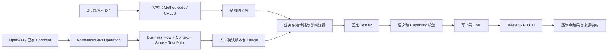

# 后端 API 测试 MVP（IR 0.1）

本模块新增 `/api/business-testing`，前端入口为 `/business-testing`。已有 `/api/scenarios` 原型继续保留；新的业务测试链路使用独立的业务知识模型、人工确认、固定版本 IR 和外部 JMeter CLI。



## 已实现范围

- 从 OpenAPI 3 JSON 导入 method/path、类型、Schema、enum、Bearer/API key 及实现定位；解析本地 `$ref`。从已有 Endpoint 导入实现事实，匹配同一 system/service/method/path 的已导入契约，避免重复填写实现坐标。缺少契约的入口可以进入目录和流程草稿，不能生成可执行场景。
- 可视化业务依赖图；连线保存原因和 DATA/STATE/AUTH/BUSINESS/ORDERING 类型。Context 的生产者和消费者自动构成依赖，画布显示推导连线。
- 业务流程使用不可变修订版。保存请求中的 `revision` 是预期当前版本；并发修改返回错误。确认绑定该版本的 hash、服务端确认人和时间。草稿、拒绝版本不能生成或运行场景。
- 一条 Flow 的多个 Test Point 可使用独立断言和输入覆盖。生成使用已确认的完整 Flow，保留全部前置与独立检查；当前不做最小路径裁剪、自动重排业务关系或自动认可新 Oracle。预期提前终止、条件分支等负向路径需要单独的已确认 Flow，不能依靠当前 Test Point 隐式跳过后继节点。
- IR 0.1 支持 HTTP/JSON、明确状态码、JSON 字段/数组下标断言、类型化输入/输出、单一 Context 写入者、实体状态前置与后置校验、每步最多 60 秒固定等待。按稳定拓扑顺序串行执行一次。
- JMX 使用固定的编译模板；变量与测试输入作为数据传入，不插入可执行脚本。HTTP 请求由 JMeter 执行。前置校验在独立 guard 中完成，失败后停止线程，不发送该操作的 HTTP 请求；全部断言通过才提交提取的 Context。
- HTTP 接口提交有界异步队列（2 个执行进程，最多 32 个等待项），支持取消和 1–3600 秒总超时。HTTP 200、进程退出码 0 都不单独构成 PASS。只有完整必需采样集合且全部业务校验通过才能 PASS；中断、超时和基础设施异常为 INCONCLUSIVE。

## 启动

需要 Java 21、项目现有 MySQL/Neo4j，以及完整的 **Apache JMeter 5.6.3** 发行目录。只有编译/下载 JMX 时不要求安装外部 JMeter；服务内只使用 JMeter 序列化库和随模块携带的 Apache 配置资源。执行前检查外部运行时版本与 HTTP/Groovy JSON 文件。

1. 对指定 Octopus MySQL 数据库执行增量脚本 [`src/main/resources/db/business-testing.sql`](src/main/resources/db/business-testing.sql)。它新增 `business_test_scenario` 和 `business_test_run`，不修改已有表；应用的 `ddl-auto` 保持 `none`。
2. 设置连接和执行环境，再启动服务：

```sh
export JAVA_HOME=/path/to/jdk-21
export SPRING_DATASOURCE_URL='jdbc:mysql://localhost:3306/octopus?characterEncoding=utf-8'
export SPRING_DATASOURCE_USERNAME='octopus'
# MYSQL_PASSWORD、NEO4J_PASSWORD 由运行环境提供
export NEO4J_URI='bolt://localhost:7687'
export NEO4J_USERNAME='neo4j'
export QUERY_SERVICE_URL='http://localhost:8080'
export JMETER_HOME='/opt/apache-jmeter-5.6.3'
export BUSINESS_REVIEWER='local-reviewer'
export TEST_ARTIFACT_DIR='/var/lib/octopus/business-tests'
./gradlew :octopus-scenario-runner:bootRun
```

默认端口 8086。确认优先使用已认证请求的 `Principal`；本地单人使用时可配置 `BUSINESS_REVIEWER`。请求体不能声明确认人。多人环境需要在接入层落实认证并把身份传到应用；本 MVP 没有新增账号、RBAC 或租户隔离功能。

3. 前端开发：

```sh
cd octopus-frontend
SCENARIO_API_TARGET=http://localhost:8086 npm run dev
```

打开 `/business-testing`。Vite 将 `/business-testing/api/*` 转到场景服务的 `/api/*`。发布静态前端时，反向代理须配置相同转发规则；SPA 页面路径与 API 前缀必须分开。

## 无需已有数据库的本地演示

从仓库根目录运行：

```sh
JMETER_HOME=/opt/apache-jmeter-5.6.3 ./gradlew :octopus-scenario-runner:businessTestingDemo
```

该 **test source set** 入口启动临时 Neo4j、内存 H2、回环 HTTP 模拟服务，在 `127.0.0.1:18086` 提供真实 Spring HTTP/JPA 接口。日志中的 `ISOLATED_BUSINESS_TESTING_READY` 给出模拟服务的 execution profile。前端使用 `SCENARIO_API_TARGET=http://127.0.0.1:18086`。退出后演示数据库不保留，不连接现有数据库；模拟 token 流程用于验证平台机制，业务规则需替换为实际系统的定义。

演示已保存一个未确认的两步流程。选择该草稿，检查输入、token 提取及 `ok == true` 断言，确认后生成场景，填入日志提供的 profile，再运行。示例定义位于 [`examples/business-testing`](examples/business-testing)。示例 Flow 中的 `revision: 0` 适用于首次保存，实际 Operation 引用必须包含目录里的 revision。

## 数据与语义约定

### 两张图

实现图继续使用现有 `(MethodNode)-[:CALLS]->(MethodNode)`，每次查询同时限制 projectId、branch、commitId 与边版本，不沿 `SPRING_DI` 注入关系证明方法调用。

业务图增量：

| 节点 | 唯一键 | 关系 |
| --- | --- | --- |
| ApiOperation | operationId + revision | IMPLEMENTED_BY → 精确版本 MethodNode |
| BusinessFlow | flowId + revision | CONTAINS → FlowNode；HAS_TEST_POINT → TestPoint |
| FlowNode | flowId + flowRevision + nodeId | USES_OPERATION；DEPENDS_ON(kind, reason)；PRODUCES/REQUIRES → ContextVariable；USES_STATE_MODEL(ruleId) |
| ContextVariable | flowId + flowRevision + key | 保存类型与敏感标记 |
| StateModel | modelId + revision | 保存状态和迁移定义，不使用 CALLS |
| TestPoint | flowId + flowRevision + pointId | COVERS → FlowNode |
| BusinessImpactReport | hash | 不可变完整影响报告，包含代码证据与业务选择依据 |

`BusinessFlow.revision=0` 是写入版本分配用的内部记录，不参与业务查询。JSON 定义及图投影在同一事务写入。ApiOperation 契约修订不可改写，但允许追加实现坐标；IR 会固定生成时的完整契约快照。清理实现图后可通过 `POST /operations/refresh-implementation-links` 重建链接，声明的实现坐标仍保留。

### Context、状态和 Oracle

Context 是运行时 Map，使用 `auth.token` 等平面键；点号只是键名，不是表达式。支持 string/integer/number/boolean/object/array。每个键只能由一个初始声明或一个操作输出写入。实体 ID 建议使用 string；浏览器 JSON 编辑器遵循 JavaScript 数字精度。后端 JSON 读写保留 BigDecimal 精度，并对数值规范化后计算 hash。输入 `source` 为 `literal`、`context` 或 `secret`，后者映射到 execution profile 中声明的进程环境变量名称。

```json
{
  "inputs": {"token": {"source": "context", "value": "auth.token"}},
  "outputs": [{"key": "verification.id", "path": "$.data.id", "type": "string", "sensitive": false}],
  "states": [{
    "modelId": "order", "ruleId": "refund",
    "entityContext": "order.id",
    "observedContext": "order.observation.state",
    "observedEntityContext": "order.observation.id",
    "afterPath": "$.state", "afterEntityPath": "$.id"
  }]
}
```

状态模型示例：`{"modelId":"order","revision":"v1","entityType":"Order","states":["PAID","REFUND_PENDING"],"transitions":[{"ruleId":"refund","from":"PAID","to":"REFUND_PENDING"}],"origin":"HUMAN"}`。前置状态需要实际观察值或明确的初始事实；观察的实体 ID 必须等于目标 ID，响应中的实体 ID 和迁移目标也需匹配。后继操作使用新的输出键观察后续状态，不能覆写旧键。IR 不会因为调用了 refund 就自行认定状态已经改变。

每步必须有且仅有一个 `STATUS_EQUALS` Oracle，还可显式使用 `JSON_EQUALS`、`JSON_EXISTS` 或 `SCHEMA_CONFORMS`（见下文「回应契约校验」）。支持 `$`、`$.data.id`、`$.items[0].id`，不支持任意 JSONPath、表达式或脚本。预期拒绝的 4xx/5xx 只有明确状态码和全部业务断言通过才会 PASS。`intentionallyViolatedRule: "modelId/ruleId"` 必须对应实际使用的规则和拒绝 Oracle；执行时要求前置状态确实违反该规则，响应状态保持不变。

Schema 和 enum 是导入事实，不会自动变成业务断言；需要时显式添加 `SCHEMA_CONFORMS` 检查项。输入类型、确定性提取及人工确认的 Oracle 才决定执行判定。初始 Context 实际值不保存在场景或运行数据库中；secret 仅存引用。`literal` 会进入长期保存的 IR，应只用于可保存的测试数据。

### 影响证据

提交 `POST /api/query/business-test-impact`（code-intelligence）：

```json
{"projectIds":[1,2],"branch":"main","baseCommitId":"完整40位SHA","targetCommitId":"完整40位SHA"}
```

项目必须属于同一可访问 Git 仓库。应先完成两版本分析，并选择需要纳入传播的全部仓库模块。变更的旧坐标查询 BASE，新坐标查询 TARGET；删除 guard、方法或文件可从 BASE 图回溯。Reverse BFS 给出真实调用边组成的见证路径，不用固定深度截断，也不穷举全部路径。单版本节点/边各限制 10 万，超出返回错误。

缺少图/元数据、分析未完成或降级、读期间任务变化、未映射文件、非 Java/Go 文件改动会明确标记 `PARTIAL` 和原因。`STATIC_GRAPH` 只表示在选定的已分析静态范围内完成查询；反射、远程 RPC、动态注册等运行行为不因此获得完整覆盖保证。

场景服务的 `POST /impact` 将实现证据关联到 ApiOperation，再沿业务/Context/状态依赖传播到 Test Point。API 未映射会单独列出。完整报告持久化到 Neo4j；返回的 evidence ref 包含报告 hash。生成时验证该证据确实对应同一个 Flow 修订和 Test Point，不能随意注入字符串作为来源。

## 接口索引

以下路径均相对 `/api/business-testing`，成功响应直接返回 JSON；参数错误为 400、已知依赖不可用为 503。

| 方法与路径 | 用途 |
| --- | --- |
| GET /operations、POST /operations | 查询/保存规范化契约 |
| POST /operations/import-openapi | `{system, service, document, implementations}`；实现映射按原 OpenAPI operationId |
| POST /operations/import-endpoints | `{projectId, branch, commitId, system, service}` |
| GET /flows、GET /flows/{id}/{revision} | 查询业务知识 |
| POST /flows | 完整 Flow，revision 为预期当前版本 |
| POST /flows/{id}/{revision}/decision | `{expectedHash, accept}` |
| POST /impact | 同 code-intelligence 的双版本范围请求 |
| POST /scenarios | `{flowId, flowRevision, testPointId, changeEvidenceRefs?}` |
| GET /scenarios、GET /scenarios/{id}/ir、GET /scenarios/{id}/evidence | 固定场景与完整证据 |
| POST /ir/validate | 验证独立 IR 并返回执行顺序 |
| GET /capabilities | 当前编译器能力清单 |
| POST /scenarios/{id}/compile | execution profile → JMX、IR hash、source map、capability lock |
| POST /scenarios/{id}/runs | `{profile, timeoutSeconds}` → 202 + run |
| GET /runs、GET /runs/{id}、POST /runs/{id}/cancel | 生命周期与报告 |

Execution profile 的 `services` 按 **system.service** 取值，支持跨服务和跨系统使用同名服务。URL 仅含 HTTP(S) scheme/host/port/路径前缀，不含认证信息、query 或 fragment。请求不自动跟随重定向。

运行目录保存 `plan.jmx`、`source-map.json`、`capabilities-lock.json`、`knowledge-lock.json`、`change-evidence.json`、JTL 与进程日志。目录限制为当前 OS 用户访问；临时 `context.json` 使用 0600 并在 finally 删除。JTL 不保存请求/响应正文、头或 URL。业务报告只包含采样标签、状态码、耗时、断言 ID 等摘要。

导出的 JMX 可用完整 JMeter 5.6.3 单独运行；为 `-Joctopus.contextFile=/absolute/context.json` 提供初始 Context，并按生成时的 secret 引用配置环境变量。JMX 下载不包含运行时初始值。非平台运行的日志输出策略由执行者配置。

## Phase 1：变更闭环、契约校验、失败分析与建议度量（2026-10）

### 批量回归（变更 → 受影响测试点 → 批量执行）

`POST /api/business-testing/regression-batches`：

```json
{"projectIds":[1,2],"branch":"main","baseCommitId":"40位SHA","targetCommitId":"40位SHA（已部署到测试环境）",
 "environment":"test","timeoutSeconds":600,"initialContext":{"tenant":"qa"},"secretEnvironmentNames":{"api.key":"QA_API_KEY"},
 "triggerSource":"CI","externalRef":"jenkins#123","idempotencyKey":"ci:123","callbackUrl":"http://code-intelligence:8080/api/change-review/regression-callback"}
```

立即返回 202 和批次摘要；后台线程依次完成影响分析、为每个受影响的已确认测试点生成固定场景、按全局并发上限（`scenario.testing.regression.max-in-flight`，默认 2）提交运行，并汇总判定：任一 FAIL → FAIL；否则任一无法判定 / 跳过 / 错误 → INCONCLUSIVE；全部通过 → PASS；没有受影响测试点 → NO_AFFECTED_TESTS。

- 执行地址和初始变量来自项目背景（与运行页面「使用已保存的测试地址」相同的推导）；`initialContext` 只接受**普通测试值**，会随批次持久化。需要敏感变量的测试点会被标记为 SKIPPED 并写明原因，不会被当作通过。
- 执行队列满时条目保持 PENDING 下一轮重试；执行服务重启后遗留的 QUEUED/RUNNING 运行在超时后记为 INCONCLUSIVE。
- `GET /regression-batches`、`GET /regression-batches/{id}`、`POST /regression-batches/{id}/cancel`。前端入口「业务 API 测试 → 回归批次」。
- 回调只发往 `scenario.testing.regression.callback-allowed-prefixes` 内的地址，请求头携带 `X-Octopus-Callback-Token`（`OCTOPUS_REGRESSION_CALLBACK_TOKEN`），失败最多重试 5 次。

**接入 Gerrit**：CI 在把合入后的版本部署到测试环境后调用 code-intelligence 的 `POST /api/change-review/{taskId}/regression`（可选 `{environment, timeoutSeconds}`），它会用该变更审查任务的 base / merge commit 发起批次；批次结束后 code-intelligence 校验 token 并把摘要以评论回写到对应 change。只有为 patchset 提供预览部署时才建议开启 `octopus.change-review.regression.auto-trigger`。

### 回应契约校验 `SCHEMA_CONFORMS`

```json
{"id":"contract","kind":"SCHEMA_CONFORMS","path":"$","expected":null}
```

`expected` 为空时使用该步骤 `STATUS_EQUALS` 对应状态码在契约中的回应 Schema 校验整个回应体；也可以在 `expected` 中给出显式 Schema 并用 `path` 指向子文档。支持 type（含 null 与数组形式）、nullable、enum、const、properties、required、additionalProperties、items、长度/范围/pattern/multipleOf、uniqueItems、allOf/anyOf/oneOf/not；注释类关键字忽略。Schema 中有其他校验关键字或未展开的 `$ref` 时 IR 校验直接拒绝，避免"看似校验、实际忽略"。校验在 JMeter 子进程中由扩展执行（能力 `verify.schema`，需要更新 `octopus-jmeter-ext` distribution），违规信息只含路径与原因，最多 50 条，不含回应值。

**路径约定**：LLM 补全按「回应 JSON 位于 `$.body`」书写路径（如 `$.body.id`），人工编辑使用根路径（如 `$.id`）。运行时两种写法等价；若回应体根上确实有 `body` 字段，则按字面路径解析以兼容旧流程。LLM 不能提取或断言 `$.status`，状态码一律用 `STATUS_EQUALS`。

### AI 失败分析（只作建议）

`POST /api/business-testing/runs/{id}/triage`（可选 `{model}`）分析 FAIL / INCONCLUSIVE 运行，`GET` 读取已保存结果；报告抽屉中有「分析失败原因」按钮。模型只收到采样摘要（标签、状态码、耗时、断言 id / Schema 违规路径）、已确认的断言定义、输入的来源类型（不含字面值）与变更证据；不发送请求/响应正文、初始上下文实际值或凭据。输出必须符合固定结构（类别 PRODUCT_DEFECT / TEST_DATA / ENVIRONMENT / ORACLE_OUTDATED / TEST_DEFINITION / FLAKY / UNKNOWN、置信度、引用真实存在的步骤与断言），不合格的输出不保存。结果单独存放在 `business_run_triage`，**从不修改运行判定**；平台规则信号（基础设施错误、非 HTTP 状态码、5xx、Schema 违规、被阻断步骤、清理失败）与模型结论一起展示。

### AI 建议度量

所有经 review-agent 的模型调用都会记录类型、模型、耗时、回应长度或失败类别（不记录提示词与输出原文）；单步记忆确认与整链统一采纳记为 ACCEPTED，前端也可通过 `POST /suggestion-metrics/feedback` 上报 REJECTED / EDITED。`GET /suggestion-metrics?days=30` 按类型/模型给出调用量、失败率、采纳率与 P50/P95 耗时；`POST /suggestion-metrics/evaluate {golden, candidate}` 对比模型补全结果与人工确认的黄金流程，给出 inputs / outputs / assertions 的 precision / recall / F1（忽略输出键与断言 id 的命名差异、`$.body` 前缀差异），用于换模型或改 prompt 前后的回归对比。

新增表：`business_regression_batch`、`business_run_triage`、`business_suggestion_event`（已有库执行 `db/migrations/20261010_phase1_regression_triage_metrics.sql`）。

## Phase 2：测试能力深化（2026-10）

### 轮询（异步接口）

在步骤上设置 `poll: {"intervalMillis": 2000, "timeoutMillis": 60000}`（编辑器「更多设置 → 轮询直到检查项通过」）：重复发送同一请求（含请求预处理），直到该步骤全部检查项（状态码、JSON 断言、Schema、状态观察）通过；超过时长或次数（`timeout/interval + 1`，最多 120 次）后按普通语义判定，超时即 FAIL 并附 `poll_timeout_after_N_attempts`。中间轮次在报告中记为 `POLL_RETRY`，不提交上下文、不触发失败停止；数据库 / Redis / Kafka 验证只在轮询结束后执行一次。间隔 200 ms–30 s，总时长 1–300 s；清理步骤不支持轮询。能力 `http.poll`，只依赖 JMeter 内置的 While 控制器。

### 运行租约与遗留运行回收

每个运行记录所属进程（`worker_id`）与心跳（`heartbeat_at`，默认每 15 秒）。心跳超过 `lease-seconds`（默认 120 秒）且不属于当前进程的 QUEUED / RUNNING 运行会被标记为 `INTERRUPTED`（判定 INCONCLUSIVE）：
QUEUED 说明“尚未开始执行，可直接重新运行”；RUNNING 说明“可能已部分调用被测接口，请检查测试数据后再重新运行”。**不会自动重放**。回收时会结束该运行目录下残留的 JMeter 进程，并删除 `context.json` / `connections.json` / `environment.json` 等含敏感值的临时文件，保留 JTL 等证据。多实例部署安全（只回收心跳过期的运行）。

### 运行历史与不稳定标记

`GET /api/business-testing/history?flowId=&testPointId=&limit=50` 返回测试点的运行历史，并按流程修订版给出不稳定判定：最近 10 次已结束运行中 PASS 与 FAIL 都出现且相邻翻转至少 2 次。这是启发式提示（部署版本变化也可能造成翻转）；批量回归中失败的测试点若被判为不稳定，原因中会附带提示，判定不变。

### 数据驱动执行

`POST /api/business-testing/data-runs`：`{scenarioId, services, environment?, secretEnvironmentNames?, initialContext?, rows:[{name, initialContext}], timeoutSeconds?}`。同一个已确认场景按行运行，每行只替换初始变量（流程通过 `source=context` 引用），不改变已确认的业务预期；需要不同预期的数据应建成独立测试点。数据行会持久化，只接受普通测试值，声明了敏感初始变量的场景请改用 secret 引用。判定：任一行 FAIL → FAIL；否则任一行无法判定 → INCONCLUSIVE；全部通过 → PASS。`GET /data-runs?scenarioId=`、`GET /data-runs/{id}`、`POST /data-runs/{id}/cancel`。

### AI 负向用例草稿

「生成用例候选 → AI 建议负向用例」或 `POST /api/business-testing/case-candidates/negative-suggestions {flowId, flowRevision, testPointId, limit≤10, goal?}`。模型只提出目标调用、输入覆盖值、拒绝状态码与业务拒绝断言；截止步骤、覆盖范围与输出抑制由平台按确定性负向规则构造。输入端口与类型、敏感参数、状态码与断言路径都对照已确认契约校验，不满足时候选标记为“待补充”（BLOCKED）并写明原因。结果只是草稿，加入流程后仍需保存并确认新版本。

新增表 `business_data_run` 与 `business_test_run` 的 `worker_id`、`heartbeat_at` 列（已有库执行 `db/migrations/20261012_phase2_run_lease_data_run.sql`）。

## DSL I1：YAML 场景、JMeter 扩展与轮询授权（2026-10）

需求见 [DSL_REQUIREMENTS.md](DSL_REQUIREMENTS.md)，实施计划见 [DSL_IMPLEMENTATION_PLAN.md](DSL_IMPLEMENTATION_PLAN.md)。本增量不调用 LLM 完成转换。

**DSL 工作台**（`/business-testing/dsl`）：编写 YAML 场景，实时 lint（一次报告全部问题，带行列号与建议），选择固定的分支/提交后「转换预览」或「保存为草稿」。

- 写法：`- POST /orders` 简写，或 `call` + `with`（路径参数 / 请求体顶层字段 / 查询 / 契约声明的请求头）+ `headers` + `as` + `expect` + `wait` + `poll` + `cleanup`。值可以是字面量、`${别名.字段}`、`${env.x}`、`${secret.x}`、`${input.x}`、`${fn.函数(参数)}` 或 `"Bearer ${secret.token}"` 这样的拼接；字面量中的 `${` 写作 `$${`。在 `{ }` / `[ ]` 中使用 `${...}` 需加引号。
- 断言：`status 200`、`$.state == "PAID"`、`$.id exists`、`conforms`，或映射 `{status: 409, $.code: ORDER_NOT_PAID}`。负向步骤（4xx/5xx）必须带业务断言且是最后一步，自动截止并抑制输出。自然语言与 `db:` / `redis:` / `kafka:` 验证在 I1 只提示“需要推导”，草稿列为待补充。
- 严格线性：`if`、`loop`、`retry`、`parallel` 等控制键直接报错；转换结果每步一个 SERIAL 阶段；编译后由 `JmxLinearGuard` 校验 JMX 只含固定脚手架（While 仅用于已授权轮询，脚本必须逐字等于平台模板）；JMeter 以 `httpclient4.retrycount=0` 运行，业务请求不做传输重试。
- 确定性推导（均标注来源）：契约中唯一的成功状态码；同名同类型（或 `别名Id` ↔ `id`）的必填参数依赖，标为“规则推导·待核对”；函数版本按目录固定。其余缺失项列为 pending，不猜测。
- 双向转换：`GET /dsl/render?flowId&revision` 把任意有序流程渲染为规范 DSL（只输出声明项）；DSL 来源的流程渲染再转换得到哈希相同的 Flow。含 PARALLEL、状态约束、数据层断言的流程会明确报错而不是静默丢失。保存草稿时若定义未变化（只改注释/格式）不产生新修订版，并在 `business_dsl_source` 记录 DSL 哈希与 Flow 哈希。

**JMeter 扩展与函数**（`/business-testing/extensions`）：

- 扩展开发：依赖 `octopus-jmeter-sdk`（仅编译期），在 JMeter 函数类上标注 `@OctopusTool`/`@ToolParam`/`@ToolOutput`/`@ToolExample`/`@ToolError`，建议继承 `OctopusFunction`；类名需含 `.functions.` 与版本段（如 `com.acme.functions.v1_0_0`）。见 [SDK 说明](../octopus-jmeter-sdk/README.md)。
- 上传后：ASM 读取字节码与注解（不加载、不执行）→ JMeter 合规与元数据契约校验 → 安全扫描（进程、网络、脚本引擎、JNDI 等直接拒绝；文件、反射、线程、读写 JMeter 变量等作为警告）→ 与已发布扩展的版本 / 类名冲突检查 → 隔离 JMeter 子进程按 JMeter `ClassFinder` 规则发现并执行全部示例（PURE 执行两次）→ 通过即可由上传者直接发布（无人工审核）。发布时 JAR 安装到 `JMETER_HOME/lib/ext/octopus-x-*.jar` 并写入 `octopus-extensions.json`；运行前核对 SHA-256，不一致则拒绝运行。运行时与 JMeter 同进程，不做运行时隔离。
- I1 中扩展可用于 `REQUEST_VALUE` / `REQUEST_TRANSFORM` 阶段（作为预处理计划的 `x.<name>@<version>` 动作执行；参数逐个构造为 `CompoundVariable` 并按 JMeter 规则转义，不拼接 `${__fn()}` 文本）；`RESPONSE_DECODE` / `EXPECTED_VALUE` 的运行时接入在 I2。
- 统一函数目录：平台工具 + JMeter 内置函数白名单（`jm.digest`、`jm.timeShift` 等，不暴露写变量参数）+ 已发布扩展；`GET /functions`、`/functions/describe`、`/functions/docs`、`POST /functions/try`（仅 PURE、普通字面量；扩展在隔离进程中试算）。步骤补全时模型通过 `search_functions` / `describe_function` / `try_function` 按需发现（每次补全最多 10 次调用、6 轮、5 次试算），目录不会整体注入提示。

**轮询授权**：轮询只允许用于使用者在「轮询授权」中对具体 API（项目 + 方法 + 路径 + 签名）显式授权、并设定间隔 / 最大次数 / 超时的接口；平台不根据 HTTP 方法、只读标注或文档推断。步骤参数只能等于或严于授权；DSL `poll: true` 使用授权参数。Flow 固定 `授权ID@修订号`，授权被修改或撤销后引用它的流程不能确认或运行。Phase 2.1 已有的轮询流程需补充授权后才能继续运行。

迁移：执行 `src/main/resources/db/migrations/20261014_dsl_extensions_poll_authorization.sql`；重新安装 `./gradlew :octopus-jmeter-ext:distribution`（含 `ExtensionProbe` 与 SDK）。

接口：`POST /api/business-testing/dsl/lint`、`/dsl/translate`、`GET /dsl/render`、`/dsl/schema`；`/extensions`（上传、发布、停用、启用、弃用、文档）；`/functions`（检索、描述、文档、LLM 工具定义、试算）；`/poll-authorizations`（授权、撤销）。

## 扩展边界

当前 capability registry 仅注册 `http`、`json`。`crypto.*`、JDBC/Redis/MQ、gRPC、XML/protobuf、任意脚本、poll/retry、并发、条件分支、复合流程尚未实现；未知字段/能力在读入、校验或编译阶段报错，不会静默降级。后续应新增受控 Compiler adapter 和运行时插件清单，业务 IR 继续不出现 sampler 或 plugin 类名。

当前实现是单服务实例内的进程监督与队列，不是分布式 worker 调度器。服务意外退出后，遗留 RUNNING/QUEUED 记录不会自动重放；需检查残留 JMeter 进程后再处理，不能靠重新提交掩盖可能已执行的副作用。后续生产化需要 worker 所有权、恢复/租约、制品留存清理和服务访问控制。

代码状态事实抽取与自动生成更多负向 Test Point 是后续阶段；失败分析已在 Phase 1 以只作建议的形式提供（见上文）。本次的生成、依赖推导、影响传播、绑定和判定均为确定性处理；模型输出将来仍需经过同一确认与验证边界。

## 验证

```sh
JAVA_HOME=/path/to/jdk-21 JMETER_HOME=/opt/apache-jmeter-5.6.3 \
  ./gradlew :octopus-scenario-runner:test
JAVA_HOME=/path/to/jdk-21 ./gradlew :code-intelligence:test \
  --tests '*ChangeMethodDetectorTest' --tests '*GitImpactCoordinatesTest' \
  --tests '*BusinessTestImpactServiceTest' --tests '*QueryEndpointRoutesTest'
cd octopus-frontend && npm run build
```

未设置 `JMETER_HOME` 时，CLI 测试显式跳过；HTTP 测试仍验证持久化和编译，但跳过运行部分。测试使用真实临时 Git、Neo4j、HTTP 服务、H2/JPA 和 JMeter；源码分析器输出在跨模块测试中是明确的 metadata fixture，不等于已验证任意真实业务仓库的静态分析覆盖率。
